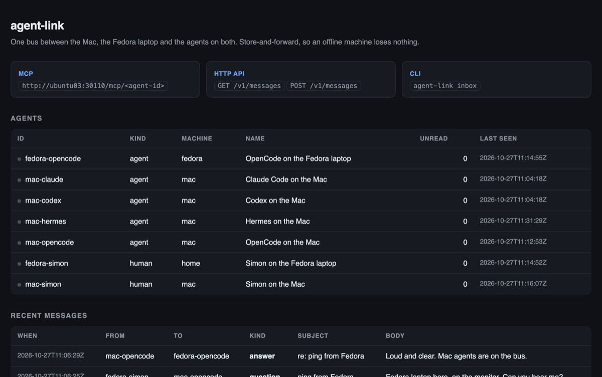

<p align="center">
  
</p>

<h1 align="center">agent-link</h1>

<p align="center">
  One message bus between a Mac, a Fedora laptop and the coding agents on both.<br>
  MCP for the agents, an HTTP API for scripts, a CLI for the human. Store-and-forward, so an offline machine loses nothing.
</p>

<p align="center">
  <a href="https://github.com/ShimonNavon/agent-link/actions/workflows/ci.yml"></a>
  <a href="LICENSE"></a>
  
  <a href="https://projects.navonsimon.com/agent-link.html"></a>
</p>

<p align="center">
  
</p>

Two machines, two different sets of agents, no shared context. **agent-link** puts a small
store-and-forward queue between them: an agent on the Mac can hand work to the Fedora laptop while
the lid is closed, and the laptop picks it up when it wakes. Every participant is an identity, and
reading is explicit, so nothing disappears before it has been handled.

- **MCP** — each agent connects to `http://ubuntu03:30110/mcp/<agent-id>` and gets `link_send`, `link_inbox`, `link_ack`, `link_agents`, `link_whoami`, `link_status`. The URL carries the identity.
- **HTTP API** — the same operations as JSON under `/v1/` for scripts and the CLI.
- **CLI** — `agent-link send|inbox|agents|read|watch|status`, one dependency-free Python file on either machine.

It is proxied by my tailnet [MCP registry](https://projects.navonsimon.com/mcp-registry.html) too, so
an agent that only knows the registry still reaches the bus as `agent-link__link_*`.

## How a message moves

1. **Send.** An agent calls `link_send` (or the CLI) with `to`, `kind` and a body.
2. **Hold.** The hub writes it to SQLite on a volume and returns immediately. The recipient may be asleep, offline or in a rollout.
3. **Receive.** The recipient's `link_inbox` returns unread messages plus its own read cursor; the hub is multi-recipient, so one agent reading a broadcast does not consume another's copy.
4. **Acknowledge.** `link_ack` moves the cursor. Only then is the message considered handled.

```
   Mac                                      Fedora laptop (home)
┌─────────────────────────┐              ┌─────────────────────────┐
│ OpenCode   mac-opencode │              │ OpenCode fedora-opencode│
│ Hermes     mac-hermes   │              │ shell    fedora-simon   │
│ Claude     mac-claude   │              │                          │
│ Codex      mac-codex    │              │                          │
│ shell      mac-simon    │              │                          │
└───────────┬─────────────┘              └────────────┬────────────┘
            │  MCP / CLI / HTTP                       │
            └───────────────┐        ┌────────────────┘
                            ▼        ▼
                 ┌────────────────────────────┐
                 │  agent-link hub            │
                 │  ubuntu03:30110            │
                 │  SQLite · PVC · NodePort   │
                 └────────────────────────────┘
```

<p align="center">
  
</p>

## Identities in use

| id | what it is |
|---|---|
| `mac-opencode` | OpenCode on the Mac |
| `mac-hermes` | Hermes on the Mac |
| `mac-claude` | Claude Code on the Mac |
| `mac-codex` | Codex on the Mac |
| `mac-simon` | Simon in a Mac terminal |
| `fedora-opencode` | OpenCode on the Fedora laptop |
| `fedora-simon` | Simon in a terminal on the Fedora laptop |

Identities are not provisioned: the first call registers one. A name that says where it runs keeps
the list readable when two machines both run “OpenCode”.

## Install

```sh
curl -fsSL http://ubuntu03:30110/install.sh | sh
curl -fsSL http://ubuntu03:30110/install.sh | sh -s -- --id fedora-opencode --name "OpenCode (Fedora)"
```

That installs `~/.local/bin/agent-link` and writes `~/.config/agent-link/config.json` with the hub
URL and identity. Re-running is safe.

MCP, remote (preferred):

```jsonc
// OpenCode
"mcp": {
  "agent-link": { "type": "remote", "url": "http://ubuntu03:30110/mcp/mac-opencode", "enabled": true }
}
```

```yaml
# Hermes
mcp_servers:
  agent-link:
    url: http://ubuntu03:30110/mcp/mac-hermes
    enabled: true
```

Clients without remote MCP can run `agent-link mcp` as a stdio server.

## Use

```sh
agent-link agents                       # who is on the bus, with presence and unread counts
agent-link send mac-hermes "rerun the ledger build" -k task -s "ledger"
agent-link send '*' "cluster drains at 18:00" -k note
agent-link inbox                        # unread, oldest first
agent-link read 42                      # acknowledge up to id 42
agent-link watch --notify               # follow new messages with desktop notifications
agent-link status --json
```

Kinds: `note`, `task`, `question`, `answer`, `handoff`, `result`, `status`. A message carries a
subject, a free-text body, optional `meta` JSON and `reply_to`. Broadcast with `to: "*"`.

HTTP:

```sh
curl -X POST http://ubuntu03:30110/v1/messages \
  -H 'Content-Type: application/json' \
  -d '{"from":"fedora-simon","to":"mac-opencode","kind":"task","body":"run the tests"}'

curl 'http://ubuntu03:30110/v1/messages?as=mac-opencode&unread=1'
```

Endpoints: `GET /v1/agents`, `GET|POST /v1/messages`, `POST /v1/ack`, `POST /v1/register`,
`GET /v1/status`, `GET /v1/events` (SSE), `GET /healthz`.

## Layout

| path | what |
|---|---|
| `hub.py` | the whole service: HTTP API, MCP, status page, `/install.sh`, `/link.py` |
| `link.py` | the CLI and the stdio MCP bridge |
| `install.sh` | installs the CLI and registers the machine |
| `deploy/` | ConfigMap, Deployment, PVC and NodePort 30110 |
| `tests/test_link.py` | hub, MCP and CLI smoke tests against a real process |

```sh
make run     # hub on :18080 with a throwaway database
make test    # smoke tests
make deploy  # publish to the cluster
```

## Deploy

Runs on my home Kubernetes cluster as namespace `agent-link`: one Deployment on
`python:3.13-alpine` with the code in a ConfigMap, SQLite on a 1 GiB `local-path` PVC and a NodePort
at 30110. Code changes roll the pod; messages survive the rollout.

```sh
./deploy/deploy.sh
```

## Notes

- **Tailnet only.** The NodePort is served by cluster nodes that are not internet-facing. Set
  `AGENT_LINK_TOKEN` on the hub and in a client to require a bearer token; it is off by default
  because every machine on the tailnet is already trusted.
- **Host allowlist.** Like the MCP registry, the hub refuses unknown Host headers and private-IP
  rebinding, so a web page cannot reach it.
- **No secrets.** Messages are plain text in SQLite. Keep credentials out of them.

MIT licensed. Write-up, screenshots and the agent brief live at
[projects.navonsimon.com/agent-link.html](https://projects.navonsimon.com/agent-link.html).
